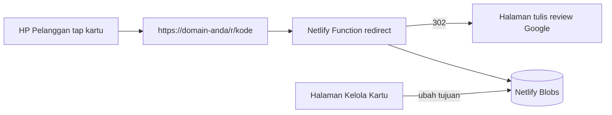

# 📇 Aktivasi Kartu NFC Review Google Maps

Web app untuk menulis link **review Google Maps** ke kartu NFC langsung dari **Google Chrome di HP Android** (Web NFC), dengan **link pengalih** yang tujuannya bisa diubah kapan saja walau kartu sudah dikunci.



## Fitur

| Fitur | Keterangan |
|---|---|
| Pencarian toko se-Indonesia | Google Maps **Places API (New)** `PlaceAutocompleteElement`, fallback ke Autocomplete lama |
| Mode Tes / Place ID | Tes tulis NFC tanpa API Key; input Place ID atau link review (divalidasi https + domain Google) |
| Link Pengalih `/r/kode` | Tujuan bisa diubah/dinonaktifkan dari halaman **Kelola Kartu**, ada statistik jumlah scan |
| Link Langsung | Opsi tanpa server, langsung link Google |
| Pengaman Mode Testing | Kunci Read-Only **mati secara default**, wajib konfirmasi sebelum mengunci |
| Cek kapasitas chip | Estimasi byte & peringatan jika tidak muat di NTAG213 |
| Keamanan | API Key & token hanya dari Environment Variables, CSP, noindex, allowlist domain tujuan (anti phishing redirect) |

## Struktur Proyek

```
nfccard/
├── public/                    ← satu-satunya folder yang dipublikasikan
│   ├── index.html             ← Halaman Aktivasi Kartu
│   ├── admin.html             ← Halaman Kelola Kartu
│   ├── 404.html, robots.txt
│   ├── config.js              ← DIBUAT SAAT BUILD (di-.gitignore)
│   └── assets/
│       ├── app.js             ← logika aktivasi + Web NFC
│       ├── admin.js           ← logika kelola link
│       ├── common.js          ← validasi & helper bersama
│       ├── style.css
│       └── favicon.svg
├── netlify/
│   ├── functions/
│   │   ├── redirect.mjs       ← GET /r/:code → 302 ke Google
│   │   └── links.mjs          ← API admin /api/links (butuh ADMIN_TOKEN)
│   └── lib/links.mjs          ← validasi, auth, akses Netlify Blobs
├── scripts/build-config.mjs   ← tulis public/config.js dari env
├── netlify.toml               ← build, functions, header keamanan
├── package.json
├── .env.example               ← template env (tanpa rahasia)
└── .gitignore
```

---

## 1. Siapkan Google Maps API Key

1. Buka [Google Cloud Console](https://console.cloud.google.com/) → buat/pilih project → aktifkan **Billing**.
2. **APIs & Services → Library**, aktifkan:
   - **Maps JavaScript API**
   - **Places API (New)**
3. **APIs & Services → Credentials → Create credentials → API key**, lalu **Edit API key**:
   - **Application restrictions** → *Websites* → tambahkan:
     ```
     https://NAMA-SITUS.netlify.app/*
     http://localhost:8888/*
     ```
   - **API restrictions** → *Restrict key* → pilih **Maps JavaScript API** dan **Places API (New)**.
4. **Billing → Budgets & alerts** → buat budget (mis. Rp100.000/bulan) dengan alert email.
5. (Opsional) **APIs & Services → Places API (New) → Quotas** → batasi request per hari.

> Tanpa langkah 3, API Key Anda bisa dipakai orang lain dan tagihan menjadi milik Anda.

## 2. Buat Token Admin

```powershell
npm run token
```
Simpan hasilnya (contoh: `p4P0...`). Token ini dipakai untuk masuk ke halaman **Kelola Kartu** dan mendaftarkan link saat aktivasi.

## 3. Push ke GitHub

```powershell
git add -A
git commit -m "NFC review card activator"
git remote add origin https://github.com/USERNAME/nfccard.git
git push -u origin main
```

Pastikan `git status` **tidak** menampilkan `.env` atau `public/config.js`.

## 4. Deploy ke Netlify

1. [app.netlify.com](https://app.netlify.com) → **Add new project → Import an existing project → GitHub** → pilih repo `nfccard`.
2. Build settings otomatis terbaca dari `netlify.toml` (publish `public`, command `npm run build`).
3. **Site configuration → Environment variables → Add a variable**:

   | Key | Value |
   |---|---|
   | `ADMIN_TOKEN` | token dari langkah 2 |
   | `GOOGLE_MAPS_API_KEY` | API Key dari langkah 1 |
   | `REDIRECT_MODE` | `on` |

4. **Deploys → Trigger deploy → Deploy site** (env baru berlaku setelah deploy ulang).
5. (Opsional) **Domain management** → ganti nama situs / pasang domain sendiri. Jika ganti domain, **perbarui juga HTTP referrer** API Key di Google Cloud.

> ⚠️ Netlify Drop (drag & drop) **tidak** mendukung Functions. Gunakan import dari GitHub atau `netlify deploy`.

## 5. Cara Pakai

### Aktivasi kartu (di HP Android, Chrome)
1. Buka `https://NAMA-SITUS.netlify.app` → pastikan NFC HP menyala.
2. **Langkah 1** – cari toko di Google Maps (atau pakai *Mode Tes*).
3. **Langkah 2** – pilih **Link Pengalih**, masukkan **Token Admin** sekali (tersimpan di HP), isi kode kartu (opsional).
4. **Langkah 3** – biarkan **kunci tidak dicentang** saat testing → tekan **Aktivasi & Tulis** → tempelkan kartu.
5. Tes: keluar dari Chrome, tempelkan kartu → harus membuka halaman review toko.
6. Untuk kartu final: centang **Kunci kartu permanen** → tulis ulang.

### Kelola kartu
Buka `https://NAMA-SITUS.netlify.app/admin.html` → masukkan token →
ubah tujuan, nonaktifkan, hapus, salin/uji link, lihat jumlah scan.

---

## Pengembangan Lokal

> Web NFC **wajib HTTPS + Chrome Android**, dan Functions tidak berjalan di Laragon. Laragon hanya cocok untuk melihat tampilan.

```powershell
copy .env.example .env      # lalu isi ADMIN_TOKEN & GOOGLE_MAPS_API_KEY
npm install
npm run dev                 # build config + netlify dev → http://localhost:8888
```

Untuk tes NFC dari HP saat lokal, gunakan tunnel HTTPS (mis. `npx netlify-cli dev --live` atau `ngrok http 8888`) dan tambahkan domain tunnel ke HTTP referrer API Key.

Cek sintaks semua file JS: `npm run check`

---

## Checklist Sebelum Live

- [ ] `Maps JavaScript API` + `Places API (New)` aktif, billing aktif
- [ ] API Key dibatasi **HTTP referrer** + **API restrictions**, budget alert terpasang
- [ ] `ADMIN_TOKEN` (≥ 24 karakter acak) & `GOOGLE_MAPS_API_KEY` di-set di Netlify, lalu deploy ulang
- [ ] `.env` dan `public/config.js` tidak ada di GitHub
- [ ] Buka `/admin.html` → login berhasil
- [ ] Tes Mode Tes (Google Sydney) → tulis kartu → tap → halaman review terbuka
- [ ] Tes pencarian Maps → pilih toko Indonesia → tulis kartu → tap
- [ ] Ubah tujuan di Kelola Kartu → tap kartu yang sama → tujuan baru terbuka
- [ ] Tes baca kartu di **Android** dan **iPhone XS ke atas** (layar menyala, tanpa aplikasi)
- [ ] Tes **kunci kartu** pada 1 kartu cadangan
- [ ] Gunakan chip **NTAG213/215/216** (cek info ukuran di Langkah 3)

## Pemecahan Masalah

| Gejala | Solusi |
|---|---|
| "Browser ini belum mendukung Web NFC" | Gunakan Chrome Android (bukan iPhone/desktop/Samsung Internet), via HTTPS |
| "API Key ditolak Google" | Aktifkan Places API (New), cek billing, cek HTTP referrer cocok dengan domain |
| Dropdown Maps tidak muncul | Places API (New) belum aktif, atau CSP diubah |
| "API tidak ditemukan" | Situs dibuka dari Laragon/file lokal. Gunakan URL Netlify atau `npm run dev` |
| "ADMIN_TOKEN belum diset" | Isi env di Netlify lalu **deploy ulang** |
| "Token admin salah" | Token tidak sama dengan env `ADMIN_TOKEN` |
| "Kartu terlepas saat proses" | Tahan kartu 2–3 detik di area NFC (biasanya tengah/atas punggung HP) |
| Gagal menulis kartu | Kartu sudah terkunci, bukan NTAG/NDEF, atau rusak — coba kartu lain |
| Tap kartu → "Kartu belum diaktifkan" | Kode tidak ada di Kelola Kartu (terhapus) |

## Kebijakan Google

Jangan memberi hadiah, diskon, atau imbalan apa pun sebagai syarat menulis review, dan jangan hanya meminta review positif. Pelanggaran dapat membuat review toko dihapus. Lihat [Kebijakan konten Google Maps](https://support.google.com/contributionpolicy/answer/7400114).
